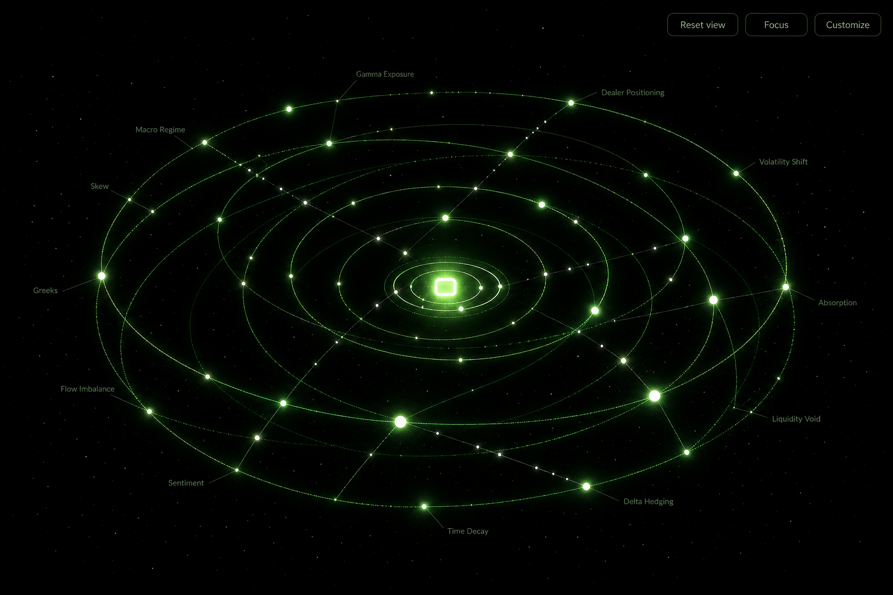

# Nebula Nested

A fork of [7evyr/obsidian-nebula](https://github.com/7evyr/obsidian-nebula) that draws **a ring for every folder *and* every subfolder**, not just the top-level ones.

In the original, `vault.getMarkdownFiles()` is cut at the first `/`, so `OptionsFlow/Greeks/Gamma.md` and `OptionsFlow/Volatility/VIX.md` land on the *same* ring and the hierarchy is lost. Here the folder tree is walked properly.



> The image above is a **mockup of the intended look** (the real thing is drawn with three.js bloom).
> To see the actual render, open `preview/index.html` — see [Preview without Obsidian](#preview-without-obsidian).

## What changed

| | Original Nebula | Nebula Nested |
|---|---|---|
| Rings | one per **top-level** folder | one per folder at every depth |
| Nesting | none | child folders orbit their parent, on outer shells |
| Angular layout | random angles | siblings tile their parent's arc, sized by note count |
| Container folders | get a ring even when empty | collapsed; only folders that hold notes get a ring |
| Labels | top folders only | every ring, scaled and dimmed by depth |
| Controls | look | look **+ structure** (depth, max rings, spacing, arcs, depth fade, root notes) |
| Extra | — | `Copy folder outline to clipboard` command, layout self-audit, 22 unit tests |

### How the nesting reads

```
                    core (hub)
                       │
        ┌──────────────┴──────────────┐
   shell 1:  ┌── Greeks ──┐     ┌── Volatility ──┐     one arc per top folder,
             │  ·  ·  ·   │     │   ·   ·   ·    │     full circle shared between them
             └────────────┘     └────────────────┘
   shell 2:        └── Dealer Positioning ──┐           subfolders live on the next shell,
                        ·  ·  ·  ·  ·  ·    │           inside their parent's arc
   shell 3:                  └── 0DTE ──┐                 and so on, outward
```

Depth = distance from the centre. Position on the ring = which branch of the tree you're in.

## Install

1. Copy the contents of [`dist/`](dist) (`main.js`, `manifest.json`, `styles.css`) into
   `<your vault>/.obsidian/plugins/nebula-nested/`.
2. Reload Obsidian, then enable **Nebula Nested** in *Settings → Community plugins*.
3. Click the orbit icon in the left ribbon, or run **Nebula Nested: Open view**.

No build step is needed to use it — `dist/` is committed. Desktop only (it uses WebGL).

### Upgrade from the original Nebula

They have different plugin ids (`nebula` vs `nebula-nested`), so both can be installed side by side while you compare. Disable whichever you prefer.

## Use

- **Drag** to spin, **right-drag** to move, **scroll** to zoom.
- **Click a star** to open that note in a split pane (`Cmd/Ctrl`-click for a new tab).
- **Click a folder name** to fly to its ring.
- **F** toggles focus mode, **Esc** leaves it.
- **Customize → Structure**: nesting depth, max rings, ring spacing, sub-ring arcs, depth fade, root notes. These rebuild the scene and keep your camera position.

### Structure settings, in plain terms

| Setting | What it does |
|---|---|
| **Nesting depth** | how many folder levels to draw (1 = flat, the old behaviour) |
| **Max rings** | cap on total rings, biggest subtrees kept first. Prevents 2000-folder vaults from turning into soup |
| **Ring spacing** | distance between shells |
| **Sub-ring arcs** | on: nested folders draw an arc inside their parent. off: full circles at their own radius |
| **Depth fade** | dim deeper rings so the top level stays legible |
| **Root notes** | show notes sitting loose in the vault root as a halo around the hub |

## Why container folders are collapsed

A vault like

```
01 OptionsFlow/
   ├── Greeks/            ← holds notes
   ├── Dealer Positioning/ ← holds notes
   └── (no notes of its own)
```

would otherwise give `01 OptionsFlow` an empty ring and put its children on the same shell, which looks broken. Pure containers are therefore collapsed: they still shape the hierarchy, but only folders that **directly hold notes** get a ring. A folder that holds notes *and* subfolders keeps its own ring, and its children nest inside it.

## Build

```bash
npm install
npm run build     # -> dist/main.js + manifest.json + styles.css
npm test          # 22 geometry/model tests, no browser needed
```

`npm test` covers the parts that are easy to get subtly wrong: container collapsing, reparenting, arc tiling, shells being strictly ordered, deterministic layout, broken links, empty vaults, and a 960-note stress case.

## Preview without Obsidian

```bash
cd preview && python3 -m http.server 8080
```

`preview/index.html` renders a demo vault shaped like a real one using the real layout and renderer code. `preview/preview.js` is the bundled demo; rebuild it with:

```bash
npx esbuild src/preview.js --bundle --format=iife --platform=browser --target=es2020 --outfile=preview/preview.js
```

## Layout algorithm, for the curious

1. Walk every note path, registering all ancestor folders.
2. Keep folders that (a) directly hold ≥1 note, (b) are within `maxDepth`, then cap at `maxRings` by subtree size.
3. Reparent each kept folder to its nearest kept ancestor.
4. Allocate angular wedges top-down: children tile their parent's arc proportionally to their subtree note count.
5. Radii come from a per-level shell, offset within the shell by sibling index so no two rings coincide.
6. Stars sit in a thin band around their folder's arc, seeded by a hash of the note path, so the shape is stable between reloads.
7. `auditLayout()` re-checks the result (nothing inside the hub, deeper shells strictly outside shallower ones, no identical rings, no NaNs) and logs to the console if anything is off.

## Credits and licence

Forked from [obsidian-nebula](https://github.com/7evyr/obsidian-nebula) by 7evyr (MIT). Rendering, shaders, bloom, trackball camera, beads, comets and the customize panel all come from that project. MIT — see [LICENSE](LICENSE).
